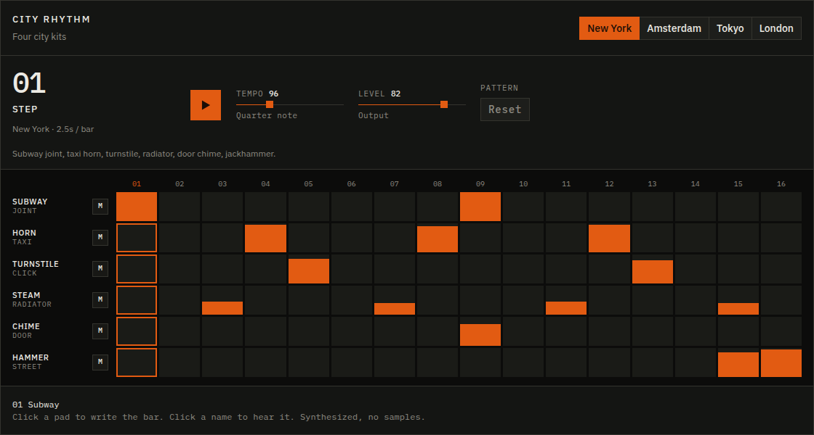

# City Rhythm

A drum machine with four city kits. Each place is a set of synthesized sounds you would hear there, laid out on a 16-step bar.



## Run

```bash
npm install
npm run dev
```

Open [http://127.0.0.1:47221](http://127.0.0.1:47221).

```bash
npm test
npm run build
```

## Play

Pick **New York**, **Amsterdam**, **Tokyo**, or **London**. Each city loads its own sounds, a starter pattern, and a tempo.

- **Play** runs the bar. Space does the same.
- **Tempo** is the quarter-note BPM. One step is a sixteenth note, so a bar lasts `4 × 60 / BPM` seconds.
- Click a pad to turn it on or off. Drag across pads to paint. On a touch screen, tap a pad.
- Click a name to hear that sound alone. **M** mutes the row.
- The numbers above the grid move the playhead. Left and right arrows do the same.
- **Reset** restores that city's starter pattern.

Patterns are kept in the browser while you switch cities.

## Kits

All sounds are synthesized in the Web Audio API. No samples, no recordings.

| City | Sounds | Starter tempo |
| --- | --- | --- |
| New York | Subway joint, taxi horn, turnstile, radiator steam, door chime, jackhammer | 96 |
| Amsterdam | Tram gong, bike bell, cobbles, canal slap, carillon, bridge horn | 112 |
| Tokyo | Train, crossing signal, ticket gate, rail clack, door chime, temple bowl | 120 |
| London | Clock bell, tube doors, cab horn, bus bell, rain, diesel | 92 |

The Tokyo crossing is two short beeps, in the manner of a pedestrian signal, not a station melody. The London and Amsterdam bells are single strikes, not clock tunes.
