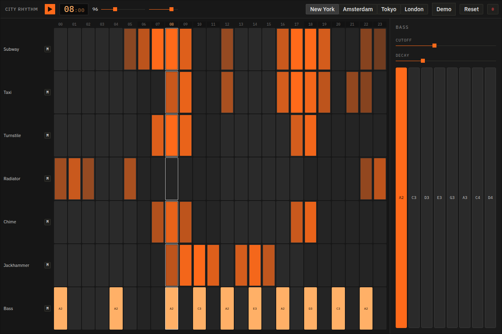

# City Rhythm

A drum machine with four city kits. Each step is an hour, so a pattern is one day in that city.



## Run

```bash
npm install
npm run dev
```

Open [http://127.0.0.1:47221](http://127.0.0.1:47221).

```bash
npm test
npm run build
```

## Play

Pick **New York**, **Amsterdam**, **Tokyo**, or **London**. Each city loads its sounds, a starter day, and a tempo.

- **Play** runs the 24 hours. Space does the same. The clock is the current hour.
- **Tempo** is the quarter-note BPM. One hour is one beat, so a day lasts `24 × 60 / BPM` seconds.
- Click a pad to turn that hour on or off. Drag to paint. On a touch screen, tap.
- The bottom row is that city's synth. Pick a key, then click an hour to place the note. Keys `A S D F G H J K` play the keys.
- **Demo** loads a day. **Reset** clears it.
- **Record** captures one pass from 00:00. The take shows up under the rack. Save downloads it.
- Click a name to hear that sound. **M** mutes the row.

Patterns are kept in the browser while you switch cities.

## Kits

Drum hits are recorded one-shots. A track with no sample, or one that fails to load, keeps its synthesised hit. The synth lane is still synthesised. Busier hours play the same sample louder.

| City | Sounds | Starter tempo |
| --- | --- | --- |
| New York | Subway, taxi horn, turnstile, radiator, door chime, jackhammer | 96 |
| Amsterdam | Tram bell, bike bell, cobbles, canal, carillon, bridge horn | 108 |
| Tokyo | Train motor, crossing, ticket gate, rail, door, temple bowl | 118 |
| London | Clock bell, tube alarm, cab horn, bus bell, rain, diesel | 92 |

## Credits

Drum samples are for playback in this app. The full source list is in [SAMPLES.md](docs/SAMPLES.md).

Most files are CC0. Attribution is not required for those; the sources are still listed in `SAMPLES.md`.

Two files require attribution:

- Tokyo taiko, used on the Tokyo train row: “TAIKOENS.wav” by [xtrgamr](https://freesound.org/people/xtrgamr/sounds/441646/), Freesound, [CC BY 4.0](https://creativecommons.org/licenses/by/4.0/). The file in this app was converted to mono Ogg Vorbis and peak-normalised, from the official Freesound HQ preview.
- Rest-of-the-Americas bombo legüero, used on the Amsterdam bridge row: “[Bombo Legüero Grave.ogg](https://commons.wikimedia.org/wiki/File:Bombo_Leg%C3%BCero_Grave.ogg)” by ZappaMidiPF, Wikimedia Commons, [CC BY-SA 4.0](https://creativecommons.org/licenses/by-sa/4.0/). This copy was trimmed, converted to mono Ogg Vorbis, and peak-normalised. That adaptation is also shared under CC BY-SA 4.0.

Other sources, all CC0:

- Manhattan ride cymbal and New York hi-hat: [CBeeching](https://freesound.org/people/CBeeching/sounds/117002/), Freesound ([hat](https://freesound.org/people/CBeeching/sounds/75045/)).
- Brooklyn toy steel pan: [potentjello](https://freesound.org/people/potentjello/sounds/194073/), Freesound.
- Queens conga and California cajón: [FreePats World Percussion](https://freepats.zenvoid.org/Percussion/world-and-rare-percussion.html) / Versilian Community Sample Library.
- Bronx snare and Staten Island bass drum: [lennartgreen](https://freesound.org/people/lennartgreen/sounds/860525/), Freesound.
- Alaska frame drum: [cabled_mess](https://freesound.org/people/cabled_mess/sounds/345635/), Freesound.
- Hawaii ipu: [volsp](https://freesound.org/people/volsp/sounds/537190/), Freesound.
- Pacific log drum: [sgossner](https://freesound.org/people/sgossner/sounds/375655/), Freesound.
- Djembe slap: [PanPiper5](https://freesound.org/people/PanPiper5/sounds/659910/), Freesound.
- Amsterdam bicycle bell: [Soundscape_Leuphana](https://commons.wikimedia.org/wiki/File:Bicycle-bell-1.wav), Wikimedia Commons.
- London snare: [KEVOY](https://freesound.org/people/KEVOY/sounds/82249/), Freesound.
- Delhi tabla: [mmiron](https://freesound.org/people/mmiron/sounds/130425/), Freesound.
- Los Angeles timbales: [Sassaby](https://freesound.org/people/Sassaby/sounds/533089/), Freesound.
