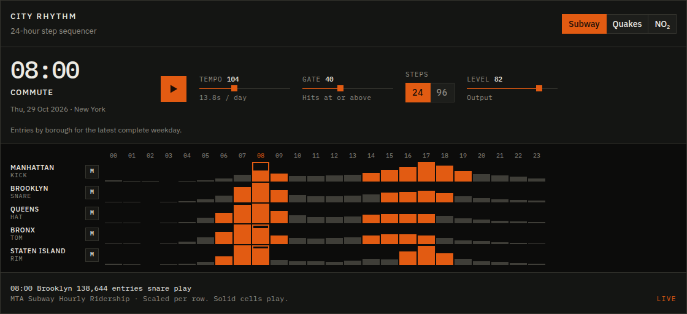

# City Rhythm

A 24-hour step sequencer. Each dataset is a day of public measurements. Each track is a place, and the hour of the day is the step.



## Run

```bash
npm install
npm run dev
```

Open [http://127.0.0.1:47221](http://127.0.0.1:47221).

```bash
npm test
npm run build
npm run refresh-data
```

`refresh-data` rewrites `public/snapshots/` from the live feeds. The app tries the live feed first and uses the snapshot if that request fails.

## Play

- **Subway**, **Quakes**, or **NO₂** selects the dataset.
- **Play** starts at the current step. Space does the same.
- **Tempo** is the quarter-note BPM. One hour is one quarter note, so a day lasts `24 × 60 / BPM` seconds at either step count.
- **Gate** is the level a step must reach before it sounds. Cells under the gate stay visible.
- **24** is one step per hour. **96** splits each hour into four equal steps that share that hour's value. The day stays the same length; 96 is sixteenths.
- **M** mutes a track. The track name previews its drum.
- Click a column to move the playhead. Left and right arrows do the same.

Drums are synthesized in the Web Audio API. No samples.

## Data

### NYC subway

[MTA Subway Hourly Ridership: Beginning 2025](https://data.ny.gov/Transportation/MTA-Subway-Hourly-Ridership-Beginning-2025/5wq4-mkjj) on data.ny.gov (`5wq4-mkjj`). No app token.

The app asks for the newest timestamp, then loads the latest complete weekday (the feed lags the calendar by a couple of weeks). Rows are summed by borough and hour in `America/New_York`.

| Track | Voice |
| --- | --- |
| Manhattan | Kick |
| Brooklyn | Snare |
| Queens | Hat |
| Bronx | Tom |
| Staten Island | Rim |

Outer boroughs usually peak on the morning commute. Manhattan usually answers in the evening, because the count is entries.

### Earthquakes

[USGS past-day GeoJSON](https://earthquake.usgs.gov/earthquakes/feed/v1.0/summary/all_day.geojson). No key. The feed is a rolling 24 hours, so each UTC hour appears once.

A quake's weight is `10^(magnitude / 2)`. Weights in the same region and hour are summed. Regions, first match wins:

| Track | Voice | Region |
| --- | --- | --- |
| Americas | Kick | Longitude −130 to −60, outside the boxes below |
| Alaska | Snare | Latitude ≥ 50, longitude −170 to −130 |
| California | Hat | Latitude 32–42.5, longitude −125 to −114 |
| Hawaii | Tom | Latitude 18–23, longitude −161 to −154 |
| Pacific | Clap | The rest of the Pacific longitudes |
| Distant | Rim | Longitude −60 to 100 |

### NO₂, six cities

[Open-Meteo Air Quality API](https://open-meteo.com/en/docs/air-quality-api) (CAMS). No key. Hourly nitrogen dioxide for New York, Amsterdam, Tokyo, London, Delhi, and Los Angeles. The sequencer uses the latest UTC day whose 24 hours have all ended. Same voices, top to bottom: kick, snare, hat, tom, clap, rim.

Amsterdam bike-share was checked and not used. Donkey Republic and OV-fiets publish a live GBFS snapshot of current bikes, not a 24-hour history, so they cannot drive this grid. Amsterdam is the snare track on NO₂ instead.

## How a measurement becomes a hit

For each track, over its 24 hours:

```
level = (value − min) / (max − min)
```

If the day is flat, every level is 0. A step sounds when `level` is at least the gate. Velocity is that level. Scaling is per track, so Staten Island can still speak at its own peak. The readout under the grid shows the unscaled figure.

At 96 steps, each hour's level is copied onto four steps. The sources are hourly (quakes are summed into the hour they struck), so the extra steps do not invent a finer measurement.

## Keys

Space plays and pauses. Arrow keys move the playhead.
